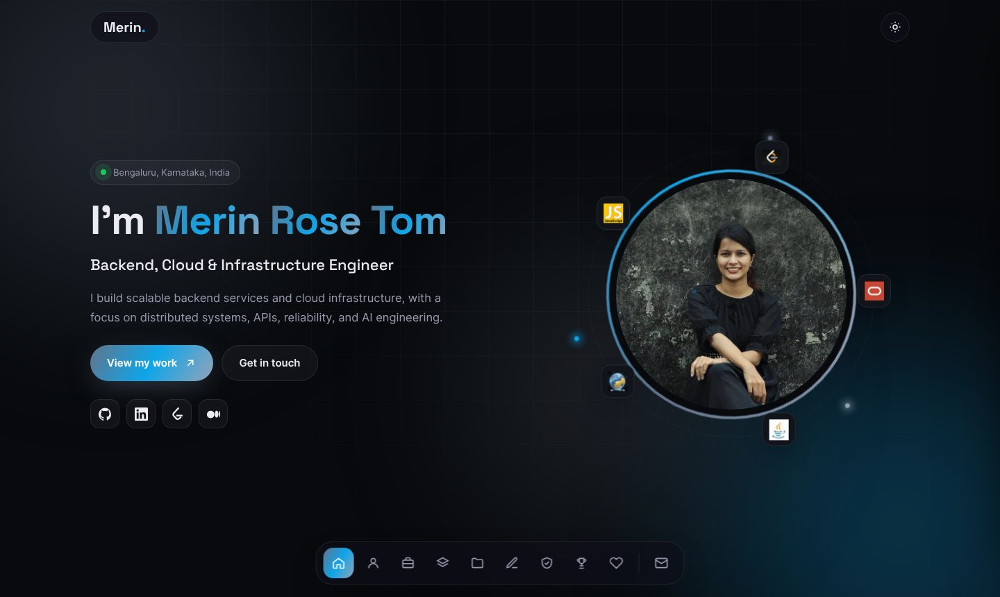

# Software Developer Portfolio Website

A modern, fully customizable portfolio website built with plain HTML, CSS and JavaScript — no frameworks, no build step. Perfect for developers, designers, and professionals to showcase their work and skills.



🌐 **Live Demo**: [https://merinrose123.github.io/merin-rose-tom/](https://merinrose123.github.io/merin-rose-tom/)

## ✨ Features

- **Modern Design**: Glassmorphism cards, gradient accents, animated background glow and grid
- **Scroll Animations**: Sections reveal on scroll, timeline line draws itself, counters count up, project images open up, parallax effects
- **Hover Effects**: Mouse-following spotlight on cards, holographic certificate cards with 3D tilt and shine, magnetic dock icons
- **Hero Section**: Profile photo in a rotating gradient ring that zooms in on hover, typing job titles, and a "Core stack" icon row with hover tooltips
- **Draggable Sliders**: The highlights strip and skill rows auto-scroll, pause on hover, and can be dragged or swiped with momentum
- **Dock Navigation**: Fixed bottom navigation bar with macOS-style magnification on desktop and a tab bar + menu sheet on mobile
- **Project Details Panel**: Click a project to open a slide-in panel with highlights and previous/next navigation
- **Themes & Colour Palettes**: Dark/light mode plus 8 accent palettes (Slate, Aurora, Ocean, Sunset, Emerald, Royal, Rose, Cyber) from the picker in the top-right corner. Slate is the default and each visitor's choice is remembered
- **Themed Scrollbar**: Custom gradient scrollbar and text-selection colour that follow the active palette
- **Responsive**: Works on desktop, tablet, and mobile (down to very small screens)
- **Multiple Sections**: Home, About, Experience, Skills, Projects, Blogs, Certifications, Achievements, Hobbies & Contact
- **Zero Setup**: Open `index.html` directly in a browser — no install, no server, no build

## 🛠️ Tech Stack

- **HTML5** - Single-page markup (`index.html`)
- **CSS3** - Custom styling, CSS variables, animations (all inside `index.html`)
- **Vanilla JavaScript** - Rendering and interactions (all inside `index.html`)
- **GSAP + ScrollTrigger** - Scroll animations (loaded from CDN)
- **Google Fonts** - Space Grotesk & Inter
- **GitHub Pages** - Free hosting

## 📁 Project Structure

```
merin-rose-tom/
├── index.html               # The whole site: layout, styles and scripts
├── data/                    # All portfolio content — one file per section
│   ├── site.js              # Page title, logo text, contact details, social links
│   ├── hero.js              # Intro, typing job titles, core-stack icons, highlights strip
│   ├── about.js             # About text & services
│   ├── experience.js        # Career & education timeline with bullet points
│   ├── skills.js            # Skill categories, names, levels (%) and icons
│   ├── projects.js          # Projects, tags, links and detail-panel highlights
│   ├── blogs.js             # Blog posts
│   ├── achievements.js      # Certifications & achievements
│   ├── hobbies.js           # Hobbies
│   └── contact.js           # "Hire me" heading & text
├── assets/
│   └── images/              # Profile picture, project images, icons, favicon
├── LICENSE
└── README.md
```

## 🎨 How to Customize

**Files to edit: everything in the `data/` folder**

Each file in `data/` holds the content for one section of the page. Open the file for the section you want to change, update the values, save, and refresh the browser.

Each file looks like this — edit the values inside the braces just like JSON (keep the quotes and commas intact):

```js
window.PORTFOLIO = Object.assign(window.PORTFOLIO || {}, {
  "blogs": [
    {
      "title": "Caching in Celery Using LRUCache",
      "description": "Implementation of caching in Celery using LRU cache algorithm.",
      "image": "assets/images/cache.png",
      "link": "https://merin-rose-tom.medium.com/caching-in-celery-using-lrucache-357053251e96"
    }
  ]
});
```

### Key things to change:
- **Personal info**: name, intro and typing job titles in `data/hero.js`; contact details in `data/site.js`
- **Projects**: add your projects with descriptions, tags and highlights in `data/projects.js`
- **Skills**: update categories, skills and levels (0–100) in `data/skills.js`
- **Experience**: career timeline and bullet points in `data/experience.js`
- **Certifications & achievements**: `data/achievements.js` — achievement icons and years are detected automatically from the text
- **Social links**: GitHub, LinkedIn, LeetCode, Medium in `data/site.js`
- **Images**: add images to `assets/images/` and reference them by path (e.g. `"assets/images/my-project.png"`)

### Advanced customization:
- **Default colours**: Set `DEFAULT_PALETTE` in `index.html` (search for it) to any palette key: `slate`, `aurora`, `ocean`, `sunset`, `emerald`, `royal`, `rose`, `cyber`
- **Palettes**: Each palette lives in the `PALETTES` list in `index.html` — `a` holds four accent colours, `dark` and `light` hold the page and card background for each mode. Edit one or add your own:
  ```js
  mytheme:{name:'My Theme', a:['#6366f1','#22d3ee','#a3e635','#facc15'], dark:['#07080c','#10121a'], light:['#f6f7fb','#ffffff']},
  ```
- **Other colours**: Text, borders and light-mode colours are CSS variables at the top of the `<style>` block in `index.html` (`:root` and `[data-theme="light"]`)
- **Navigation**: The dock items are defined in the `nav` list inside `render()` in `index.html`; `MAIN` sets which 4 sections appear in the mobile tab bar
- **Core stack icons**: Change `skillIcons` in `data/hero.js`; tooltip names come from the file name (or the matching skill in `skills.js`)
- **Layout**: Each section's HTML is a template string inside `render()` in `index.html` — add a new `<section>` there and a matching data file in `data/` (and list it in the `<script>` tags in `<head>`)

## 🚀 Getting Started

### Prerequisites
- A modern web browser (Chrome, Edge, Firefox, Safari)
- **Git** for version control

### Run locally

1. **Clone the repository**
   ```bash
   git clone https://github.com/MerinRose123/merin-rose-tom.git
   cd merin-rose-tom
   ```

2. **Open the site**

   Double-click `index.html` — that's it. No install or build needed.

   Prefer live reload while editing? Use the VS Code **Live Server** extension, or run `npx serve` in the folder.

### Deploy to GitHub Pages

1. Push your changes to the `main` branch
   ```bash
   git add .
   git commit -m "Update portfolio"
   git push
   ```
2. On GitHub, go to **Settings → Pages**
3. Under **Build and deployment**, set **Source** to **Deploy from a branch**, then choose **`main`** and **`/ (root)`**
4. Save — the site will be live at `https://<your-username>.github.io/<repo-name>/` within a minute or two

## 📄 License

This project is licensed under the MIT License - see the [LICENSE](LICENSE) file for details.

---

⭐ **Star this repo** if you found it helpful! Feel free to fork and customize it for your own portfolio.
